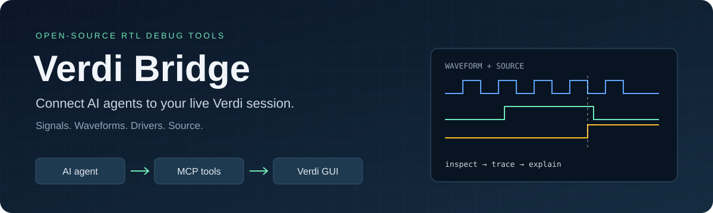
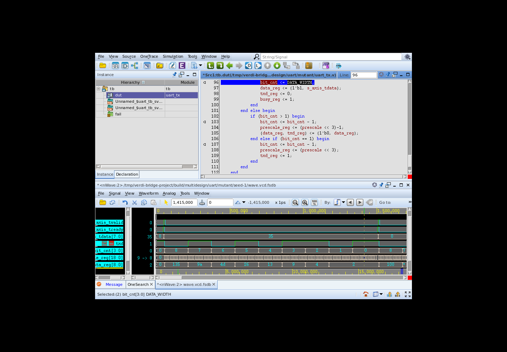

<p align="center">
  
</p>

<p align="center">
  <a href="README.md">English</a> ·
  <a href="docs/guide.md">安装与连接</a> ·
  <a href="docs/tools.md">工具接口</a> ·
  <a href="docs/multidesign-validation.md">实测报告</a>
</p>

# 让 RTL 调试 agent 看见真实波形

把 AI 助手接入正在运行的 **Synopsys Verdi**：找信号、查跳变、跳转时间、打开驱动源码，
直接操作你调试时使用的 nWave 和 nTrace 界面。

> “把 FIFO 的读写指针加进波形，跳到报错前 20 个周期，看看 full 为什么没撤。”
>
> “BVALID 到底什么时候掉下去了？把握手信号和驱动它的源码展示出来。”

Agent 负责推理，bridge 返回实际仿真证据；操作过程在 Verdi 中可见。
16 个通用 MCP 工具，支持本机和 SSH 连接。

## 视频教程

输入“现在有个 bug，帮我抓相关信号、分析问题”，看 agent 自己选信号、查波形并定位源码。约 1 分 56 秒，中文原文无声演示：左侧为真实 Codex 会话事件的同步排版，右侧为同次运行的 Verdi 录屏，未预编排工具调用。

https://github.com/user-attachments/assets/3294e374-5c43-4b67-8e20-b8a6f319d8f7

[English 原生会话](https://github.com/user-attachments/assets/b041c1bd-4be5-4040-b281-2f15001b1e35) · [中文视频](https://github.com/user-attachments/assets/3294e374-5c43-4b67-8e20-b8a6f319d8f7)

[录制说明与真实调用记录](docs/agent-demo.md) · [安装教程](docs/video-walkthrough.md)

## 开始使用

```sh
pip install verdi-bridge
```

也可以不 clone 仓库，直接运行：

```sh
uvx verdi-bridge tcl-path
```

按[连接指南](docs/guide.md)在 Verdi 中加载输出路径对应的 Tcl 适配器，
再用 `uvx verdi-bridge serve` 配置 MCP 客户端。需要已有的 Verdi 安装与许可证；
客户端 Python 3.11+，远程服务器 Python 3.6+ 和 Tcl 8.6。

## 能做什么

- 递归搜索信号、浏览设计层级，把信号加入波形。
- 测量局部时钟周期和相位，向前定位并可选对齐到实际上升沿。
- 查询指定时刻的值或整个窗口内的变化点，保留 X/Z，支持无符号 Dec 和显式有符号 SDec。
- 读取错误日志，追踪驱动，按信号或文件读取带行号的源码并跳转。

工具没有写死 FIFO 的信号或诊断规则，同一套接口已用于 UART、AXI-Lite 和仲裁器。

## 真实调试过程

已在 VCS/Verdi 中测试 UART、AXI-Lite、FIFO 和仲裁器 RTL。
Agent 可以把相关信号加入波形，读取变化点，再跳转到源码；你可以在同一界面跟随检查。



[实际 RTL 案例](docs/multidesign-validation.md) · [独立盲测](docs/blind-validation.md) ·
[验证结果与限制（包含 A/B 对照）](docs/validation-index.md)

## 当前状态

实验版 **v0.3.1**，实测版本为 Linux 上的 Verdi T-2022.06-SP2-1。
已验证新建 Verdi 会话的连接；接入任意已有 GUI 尚未单独验证。
桥接工具本身不会自动编译、修改或修复 RTL。

项目思路参考 [virtuoso-bridge-lite](https://github.com/Arcadia-1/virtuoso-bridge-lite)，
代码为独立实现，采用 MIT 许可。项目与 Synopsys 无隶属关系。

[参与开发](CONTRIBUTING.md) · [安全边界](SECURITY.md) ·
[提交问题](https://github.com/RuihongY/verdi_bridge/issues)
