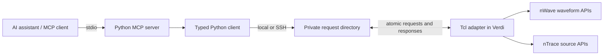

# Architecture

[Home](../README.md) · [Setup](guide.md)

The Python server exposes sixteen typed operations using the MCP SDK. Tool arguments
become data fields in a request; they are not interpolated into executable Tcl.
The adapter dispatches only supported operations in Verdi's own Tcl event loop.
No separate waveform parser or viewer is used to answer signal queries.

The transport uses a private filesystem directory rather than a network listener.
For remote use, SSH runs a small standard-library helper with Python 3.6+ on the
Verdi host. A remote Client keeps one SSH process and helper alive, exchanging
JSON lines serially. Each line still uses a fresh request ID and checks the current
GUI session. A disconnect/timeout discards the helper and never replays the call.
The next explicit call may reconnect. Set `VERDI_BRIDGE_PERSISTENT=0` for one-shot
transport. Use the Python client as a context manager or call `close()`; the MCP
server closes its client on shutdown. The MCP SDK and Python 3.11+ runtime remain on the client machine.

## Request lifecycle

1. The client reads the active session identifier and assigns a unique request ID.
2. It writes encoded arguments to a temporary file and atomically publishes the request.
3. The adapter claims the request, verifies its identity, and calls the selected Verdi API.
4. The result or error is atomically published with the same IDs.
5. The client checks the IDs before returning structured data to the assistant.

The GUI processes requests serially. Each persistent Python Client also serializes
its own calls, so a status call on that Client waits behind an interval query.
Separate Client instances can submit independently with unique request IDs, but multi-call investigations are not transactions. A user can change the
current waveform window between calls. Inspect session state when context matters.

Each directory belongs to one GUI; an exclusive lock prevents a second adapter from
consuming its requests. A request that times out before being claimed is cancelled.
A request already claimed may still complete, so mutations are not automatically
retried. A restarted GUI on the same host takes over a lock whose process is gone
and discards the previous session's requests and results.

## Boundaries

The assistant performs the diagnosis; the bridge returns observations. In the
recorded experiments, the investigator selected tool calls and proposed fixes.
The benchmark recorder merely replays those calls and saves their actual results.
It is not a hidden fault classifier or an autonomous repair service.

The private directory is a same-user trust boundary. Processes running as that user
are trusted; this is not a sandbox against them. Source reads are restricted to
separate source/log roots. No general Tcl evaluation or shell execution tool is exposed.
See [SECURITY.md](../SECURITY.md).

## Source map

| File | Responsibility |
|---|---|
| `src/verdi_bridge/server.py` | MCP tools and debugging prompt |
| `src/verdi_bridge/client.py` | Typed operations, validation and SSH invocation |
| `src/verdi_bridge/remote_io.py` | Request publication, response identity and timeouts |
| `src/verdi_bridge/bridge.tcl` | GUI event loop, operation allowlist and Verdi API calls |
| `src/verdi_bridge/cli.py` | CLI entry points |
| `examples/multidesign/` | Pinned external RTL fixtures, checks and evidence recorder |

Both adapter and helper polling default to 10 ms. Set `VERDI_BRIDGE_POLL_MS`
(1–1000) independently in the GUI and client environments to tune each side.
The adapter handles one request per event-loop callback. Interval queries have a
cooperative budget; see [tool semantics](tools.md#interval-semantics).
