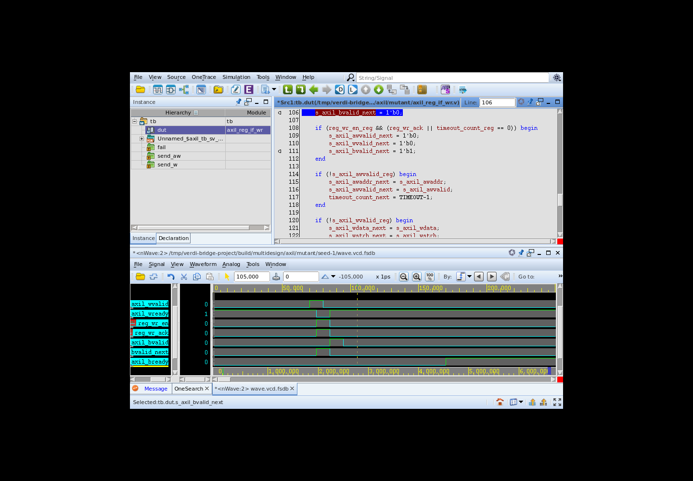
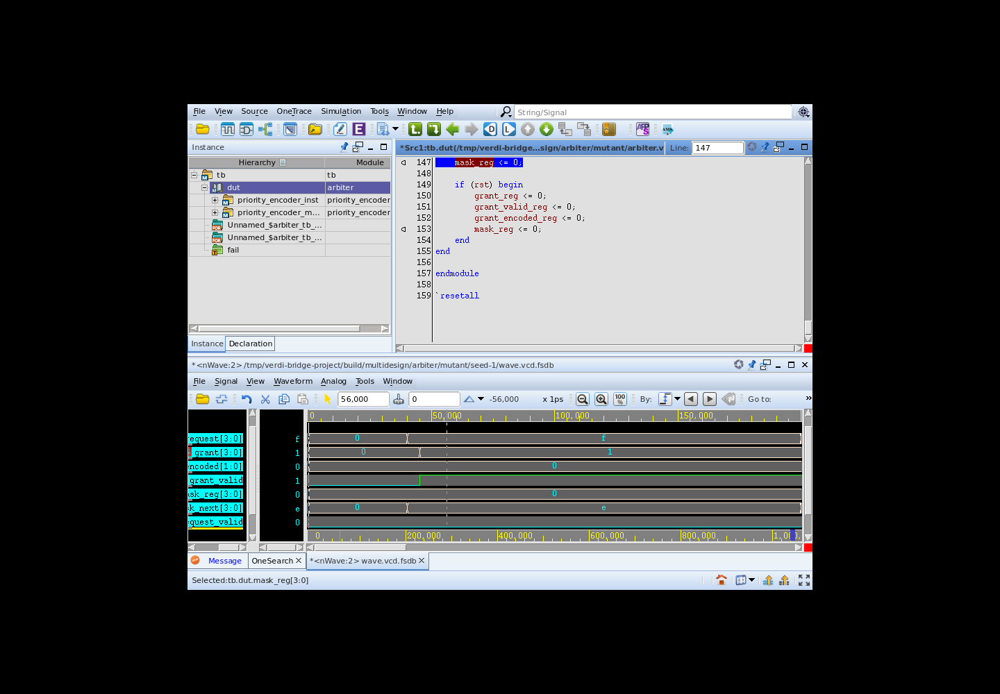

# UART、AXI-Lite 与仲裁器：跨设计验证

这次使用同一套 Verdi MCP 接口，在三个非 FIFO 开源模块上完成了
“原版通过 → 注入后报错 → 查询波形与源码 → 提出修复 → 重新仿真通过”。
桥接核心没有加入 UART、AXI 或仲裁器专用判断逻辑。

## 结果

每个模块使用种子 1、7、42，分别运行原版、注入版、修复版，共 **27 次 VCS 仿真**。
这是三个已知注入 bug，不是 27 个独立 bug；每个模块的种子 1 做了真实 Verdi/MCP 诊断。

| 设计 | 原版 | 注入版首错，种子 1/7/42 | 定位结果 | 修复版 |
|---|---|---|---|---|
| UART TX | 3/3 零错误，每次 12 帧 | 1415 / 1415 / 1415 ns | uart_tx.v:96，帧计数少装载 1 | 3/3 零错误，每次 12 帧 |
| AXI-Lite 写寄存器接口 | 3/3 零错误，每次 12 笔写入和响应 | 105 / 115 / 115 ns | axil_reg_if_wr.v:106，BVALID 未保持 | 3/3 零错误，每次 12 笔写入和响应 |
| 四端口轮询仲裁器 | 3/3 零错误，每次检查 100 轮 | 56 / 56 / 56 ns | arbiter.v:147，轮询掩码未保存 | 3/3 零错误，每次检查 100 轮 |

[完整运行结果](evidence/multidesign/simulation-results.json)、
[27 份仿真日志](evidence/multidesign/logs/)、
[注入记录](evidence/multidesign/ground-truth.json)、
[修复文件哈希审计](evidence/multidesign/repair-audit.json)。
归档日志仅移除了行末空格，便于版本管理。

## UART：少发送一个数据位

测试台根据输入握手记录待发送字节，在串行线上独立识别起始位，并在各数据位中点
采样，检查八个数据位和停止位。检查器不读取 DUT 的计数器。

第一帧是 `0x35`。MCP 返回的波形显示：

- 56 ns：起始位已拉低，但 `bit_cnt` 装载的是 8。
- 1176 ns：计数器已为 1；后续将进入源码的停止位分支。
- 1336 ns：`txd=1`、`bit_cnt=0`，提前进入停止位。
- 1415 ns：接收端应采第 8 个数据位，其期望为 0，实际却为 1。

源码中 `bit_cnt > 1` 才发送数据，`bit_cnt == 1` 发送停止位。因此初值必须包含
八个数据位加上停止位分支，即 `DATA_WIDTH+1`。第 96 行错误地写成了 `DATA_WIDTH`。

驱动追踪只返回 `txd_reg` 和 `bit_cnt` 的初始化位置（65、71 行），并未直接指出
第 96 行。诊断还读取了模块源码并结合实际位时序。

[MCP 参数与返回值](evidence/multidesign/uart-mcp.json)

## AXI-Lite：响应在背压期间消失

测试台分别发送带时序偏移的 AW、W 请求，并检查寄存器侧地址、数据和字节使能。
收到响应后，主动延迟 `BREADY`，检查 `BVALID/BRESP` 能否保持到握手。

MCP 返回：76 ns 写入接口已收到确认；86 ns `BVALID=1`，但其 next 值为 0；
96 ns `BVALID` 已下降，而 `BREADY` 始终为 0。独立的边沿检查器在 105 ns 首次报告违规。
因此故障在响应保持逻辑，而不是请求未到达或后端写入未完成。

第 106 行把 `s_axil_bvalid_next` 无条件设为 0。改回
`s_axil_bvalid_reg && !s_axil_bready` 后，未接收的响应得以保持。
寄存器追踪返回初始化行 84；继续追踪 next 信号才返回第 106 行。

[MCP 参数与返回值](evidence/multidesign/axil-mcp.json)

## 仲裁器：轮询状态无法前进

配置为四端口、最低位优先、非阻塞 round-robin。前 16 轮所有请求保持有效，之后
用不同种子改变请求组合。检查器用“从上一位获胜者之后循环寻找请求”的行为模型，
不读取也不复制 DUT 的位掩码实现。

46～106 ns 的波形显示：`request=1111`、`grant=0001`，始终授权端口 0；
`mask_next=1110` 已正确计算，但 `mask_reg` 每拍仍为 `0000`。
这将问题缩小到状态保存路径。第 147 行每拍执行 `mask_reg <= 0`；应保存
`mask_next`。独立的复位分支仍保持清零。

驱动追踪只返回寄存器初始化位置（58、81 行），最终故障语句来自后续源码检查。

[MCP 参数与返回值](evidence/multidesign/arbiter-mcp.json)

## 能证明什么，以及还不能证明什么

- 三个非 FIFO 模块复用了同一套信号浏览、采样、时间跳转、驱动追踪和源码读取工具。
- 工具调用记录器不再包含 FIFO 的固定信号列表；所有请求参数及响应都可检查。
- 每个修复都在单独目录重新编译并执行三个种子的测试；哈希审计表明修复恢复到了原版。
- 诊断是当前助手结合工具证据完成的，录制脚本仅重放已经选择好的调用，不是独立诊断器。
- **注入者与诊断者相同，已知道注入内容。这不是盲测，也不是通用定位准确率。**
  调用计划不读取注入 manifest，也没有预填故障行号，但这不消除人的先验知识。
- 三个模块均来自 Alex Forencich 的 MIT 项目，设计风格并不独立。还没有覆盖大型 SoC、
  多时钟 CDC、复杂 UVM、AXI-Lite 读路径、阻塞仲裁模式或更多参数组合。
- 仲裁器验证的是轮询状态更新；本次没有另外增加独立 FSM 模块。
- 使用 VCS U-2023.03-SP2、Verdi T-2022.06-SP2-1。原版、注入版、修复版使用相同测试台。

后续如果评估“未知 bug 的定位能力”，需要由独立注入者准备匿名案例，把故障位置与
修改记录对诊断过程隐藏，并固定模型、工具预算和评分规则。本次结果不替代该评估。
